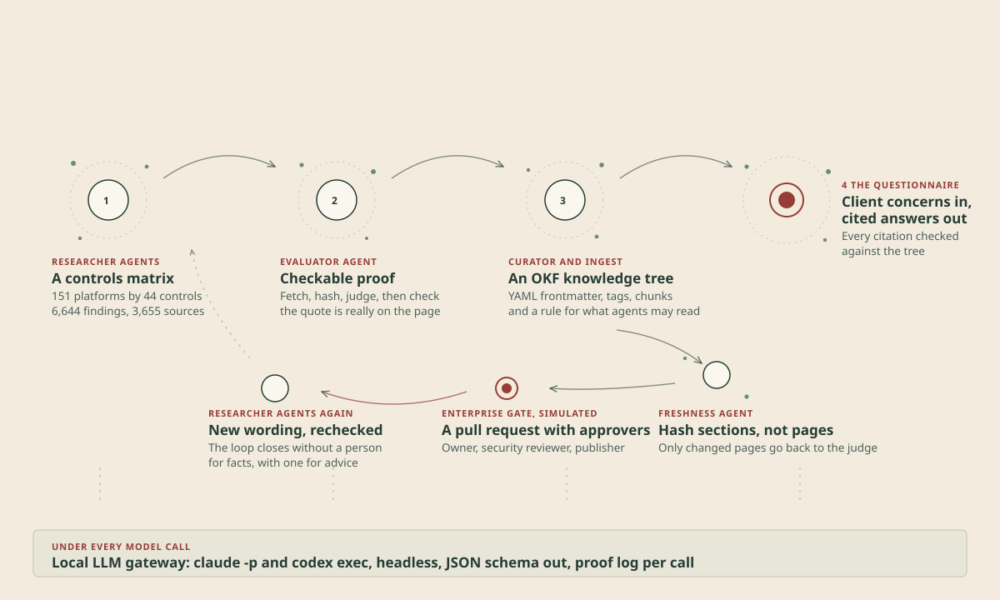

# Offerings Atlas: public sample

A public sample of the Offerings Atlas, my agent-run knowledge base of AI agent security controls. The full atlas, at release 1, covers 166 platforms and tools against 44 controls, with 7,304 researched cells. This repository holds a select sample: 27 of those platforms across all 44 controls, one or more from 20 of the atlas's 21 groups, so most of what the atlas knows is not here.

The sample is kept small on purpose, as an example that stays light enough to run in a browser. The full atlas is closed source for now. It took a good deal of research and model time to build, and I plan to release it as open source in time. Until then, this sample shows the shape of the knowledge, the rules it follows and how an agent reads it.

- **Case study:** [An agent-run knowledge base for AI agent controls](https://www.markuswalker.com/projects/offerings-atlas/)
- **Try it:** [Ask the Atlas](https://www.markuswalker.com/atlas/), an interactive questionnaire over this sample that shows how it walks the knowledge base to a cited answer



## What's in the sample

| Folder | Holds |
| --- | --- |
| `okf/atlas/` | 1,288 concepts in Open Knowledge Format v0.2: one per cell for the 27 platforms, the 44 control concepts, the tree's ingestion rules and an agent guide |
| `okf/atlas/retrieval-index.json` | The sample's retrieval index, so a reader never parses YAML: path, verdict, verification state, eligibility basis, sources and chunk names for each concept |
| `web/atlas-sample.json` | The compact data file the interactive questionnaire reads: 1,142 eligible records, the controls, maturity stages, offerings and the keyword router, plus the names of 30 more platforms the demo shows greyed out as reserved for the full version |
| `app/` | The questionnaire's browser code, with no dependencies |
| `examples/` | A synthetic client questionnaire, the model-written answer to it, and a simulated freshness pull request with an approver chain |
| `docs/` | The loop diagram |

The 27 platforms are Anthropic, OpenAI, Hugging Face, AWS, Microsoft Azure, Google Cloud, Microsoft Copilot Studio, ServiceNow, Claude Code, GitHub Copilot, Databricks, Snowflake, Microsoft Entra Agent ID, Okta for AI Agents, Wiz, Zscaler AI Security, Microsoft Purview, CrowdStrike Falcon, OneTrust, Promptfoo, LiteLLM, Kong AI Gateway, UiPath, Langfuse, Elastic, NVIDIA AI Enterprise and Macquarie Technology Group. Only the protocols and guidance group has no column here.

## How to read a concept

Each cell is one Markdown file with YAML frontmatter and chunks:

```text
okf/atlas/columns/anthropic/c1-3.md
---
type: "Platform capability"
title: "Anthropic: Human Approval"
verification: "verified"
tags: [...]
sources: [{id, resource, locator, tier}]
atlas: {platform, capability, verdict, agent_eligible, eligibility_basis, ...}
---
<!-- chunk: answer -->    what the platform offers, by which feature, and its main limit
<!-- chunk: gaps -->      what is missing or untested
<!-- chunk: options -->   how a deployment would close the gap
<!-- chunk: evidence -->  the evaluator's verdicts, with quoted passages
<!-- chunk: sources -->   the cited pages with locators
```

The states matter. A record is `agent-verified` when an evaluator found a supporting passage on a stored copy of the cited page and a pure function confirmed the quote is really there. It is `owner-accepted` when it was researched with cited sources and I accepted it for this proof of concept without an evaluator run. Thirty-three cells in the full atlas are agent verified. Ten of them are in this sample, five for Wiz, four for Anthropic and one for OpenAI, and each carries its proof. Once an evaluator has checked a cell, the owner acceptance no longer covers it, so a column with failed or pending checks shows fewer records. That's why Wiz has only six. A not-addressed cell also carries a gap label. `gap_kind` says whether the control is outside what the product is for, on an owner-accepted scope list, or a real gap. `gap_status` says which absence checks the gap has survived: most are `unchecked`, and a few are `likely` or `confirmed`. Read [okf/atlas/AGENTS.md](okf/atlas/AGENTS.md) for the rules an agent follows when it reads the tree.

## Limits

- Verdicts describe documented capability within the researched scope, not tested tenant behaviour.
- The research dates from 7 and 9 October 2026, and vendor products change.
- The client in the examples is synthetic. Nothing here is client or employer material.
- This is not advice about any vendor's current product.

## Licence

MIT, see [LICENSE](LICENSE). Quoted vendor documentation stays under its publishers' terms, see [NOTICE](NOTICE). Security reports: [SECURITY.md](SECURITY.md).
